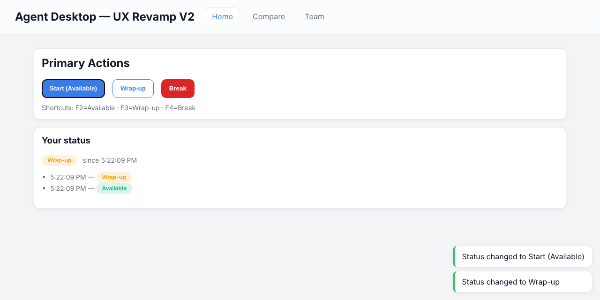

# Agent Desktop — UX/UI Revamp

**A redesign of a call-center agent's status controls: large one-click actions, F2/F3/F4 keyboard shortcuts, instant toast feedback and a small design system. It includes a side-by-side "old vs new" comparison page.**


> **ENGSE203, Week 11: UX/UI revamp** of the Agent Wallboard desktop app.



## What changed (old → new)

| Problem in the old UI | Redesign |
|---|---|
| Small, hard-to-find status buttons | Large primary actions, one click each |
| No shortcuts, several clicks per change | **F2** Available · **F3** Wrap-up · **F4** Break |
| No feedback after changing status | Toast notification, current status badge and recent history |
| Inconsistent colours, low contrast | Design tokens with WCAG AA–minded contrast |

## Implementation

- **Design system** (`src/ui/design-system.css`): colour, spacing and radius tokens, plus reusable `Button`, `StatusBadge` and `AgentCard` components
- **Keyboard shortcuts** (`src/ui/shortcuts.js`): global listener that triggers any element with `data-action="available|wrapup|break"`, so it's easy to reuse in the Electron renderer
- **Toast system:** tiny publish/subscribe store, no external library
- **Accessibility:** `aria-pressed` on the active status and `aria-keyshortcuts` on each action
- **Routes:** Home (actions), Compare (old vs new), Team (agent cards)

## Run

```bash
git clone https://github.com/tawan230666/Agent-Desktop-UX-Revamp-Vite-.git
cd Agent-Desktop-UX-Revamp-Vite-
npm install
npm start          # http://localhost:3000
```

Notes on plugging this into the Electron app (Thai) are in [UX-REVAMP-V2-NOTES.md](UX-REVAMP-V2-NOTES.md).

---

**Author:** Tawan Tiphkun (ธาวัน ทิพคุณ), [@tawan230666](https://github.com/tawan230666), Software Engineering, RMUTL Chiang Mai
